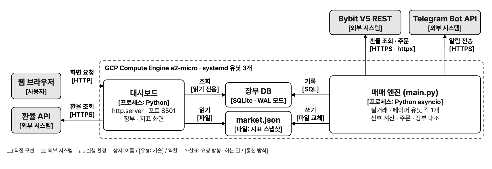

# metis-rule-trader

돈치언 채널 돌파 규칙으로 진입하고, SQLite 장부와 거래소 포지션을 대조하며 가동한 코인 선물 자동매매 프로그램입니다. 코인 자동매매 프로젝트의 규칙 기반 버전이며, AI 판단 버전은 [metis-ai-trader](https://github.com/deltaomega02/metis-ai-trader)에 있습니다.

| 항목 | 내용 |
| --- | --- |
| 구분 | 개인 프로젝트 (코인 자동매매, 2024.12 ~ 2026.09) |
| 거래소 | Bybit USDT 무기한 선물 |
| 담당 | 설계, 구현, 배포, 운영 |

## 구현 환경

| 분류 | 사용 기술 | 선택 이유 |
| --- | --- | --- |
| 언어 · 동시성 | Python · asyncio | 일이 대부분 네트워크 대기라 asyncio 단일 루프 사용 |
| 통신 | REST (4시간 주기) | 닫힌 4시간봉만 쓰고 손절은 거래소가 집행해 실시간 감시 불필요 |
| 데이터베이스 | SQLite (WAL 모드) | 엔진이 쓰는 동안 대시보드가 읽도록 WAL 사용 |
| 클라우드 플랫폼 | GCP Compute Engine (systemd) | `Restart=always`로 프로세스가 종료돼도 자동 재기동 |

## 시스템 아키텍처



| 구간 | 구성 |
| --- | --- |
| 프로세스 | systemd 유닛 3개 (`metis-v6`, `metis-v6-paper`, `metis-v6-dashboard`). `Restart=always`, `RestartSec=10`, journal 로그 |
| 엔진 | asyncio 단일 이벤트 루프 (`scheduler` → `breakout_signal` → `risk_engine` → `executor`). `httpx.AsyncClient`로 Bybit V5 REST 호출, `Semaphore(3)`으로 프로세스 전체 동시 요청 제한 |
| 저장 | SQLite WAL 모드 (포지션, 체결, 자산 곡선, 펀딩 등). 한 프로세스가 연결 하나로 쓰고, 대시보드는 읽기 전용(`mode=ro`)으로 접근. 코인별 지표는 `market.json`으로 전달 (임시 파일에 쓴 뒤 `os.replace`로 교체) |
| 대시보드 | 표준 라이브러리 `ThreadingHTTPServer`(포트 8501)와 인라인 SVG로 화면 생성. 웹 프레임워크 · 차트 라이브러리 미사용. 원화 환산용 환율만 외부 API에서 조회 |

## 구현 기능

- 4시간봉 마감 45초 뒤 실행하는 스케줄러, 8개 코인 캔들 수집
- EMA · ATR · ADX · 돈치언 채널을 numpy로 직접 구현
- 돈치언 20 돌파 + EMA 20/50 + ADX 22 진입 신호
- 손절 거리 기준 수량 산정과 진입 거부 조건 검사
- 손절가를 포함한 시장가 주문, `orderLinkId` 재시도
- 체결 목록 기반 체결가 · 수수료 기록, 펀딩 내역 기장
- 거래소 포지션과 장부 대조, 불일치 시 텔레그램 경고
- 같은 코드를 실거래와 페이퍼로 동시 가동

## 문제 해결

### 1. 손절 없는 포지션이 남는 문제: 진입 주문에 손절가 포함

- **해결**: 시장가 주문 본문에 손절가(숏은 익절가도)를 넣어 한 요청으로 전송. 거래소가 손절 설정을 거부하면 주문 전체가 거부되어 진입 생략
- **이유**: 진입과 손절 등록 사이에 프로세스가 중단되면 손절 없는 포지션이 남기 때문

### 2. 재시도가 중복 주문이 되는 문제: orderLinkId와 지수 백오프

- **해결**: 모든 주문에 고유 `orderLinkId` 부여. 네트워크 오류 · HTTP 429 · 요청 한도 오류는 대기 시간을 늘려 가며 최대 5회 재시도하고, 거래소가 ID 중복이라고 답하면 성공으로 처리
- **이유**: 응답을 받지 못한 주문을 다시 보내도 거래소가 두 번째 주문을 만들지 않도록 재시도와 중복 방지를 한 쌍으로 설계

### 3. 장부와 거래소가 어긋나는 문제: 체결 원본 기록과 포지션 대조

- **해결**: 부팅 시와 매 사이클에 거래소 포지션과 장부를 대조하고, 거래소가 손절로 닫은 포지션은 거래소의 청산 손익으로 기장. 지갑 잔액과 장부의 차이가 기준을 넘으면 텔레그램 경고
- **이유**: 손절 · 익절은 거래소가 봇과 무관하게 체결하므로 장부와 실제 포지션의 불일치 가능

### 4. 봉 마감 때 요청이 몰리는 문제: 지연 실행과 세마포어

- **해결**: 봉 마감 45초 뒤 실행하고 캔들은 0.5초 간격으로 사이클당 한 번만 받아 공유. 사이클 ID를 봉 마감 시각으로 정해 재시작 후 같은 사이클을 다시 돌려도 기록 중복 방지

## 프로젝트 구조

```text
metis-rule-trader/
├── config/
│   └── settings.py          # 설정값 단일 출처 (환경변수 매핑)
├── core/
│   ├── indicators.py        # numpy 기반 기술적 지표 (EMA, ATR, ADX, Donchian)
│   ├── breakout_signal.py   # 진입 신호 생성 및 청산 기준 판정
│   ├── risk_engine.py       # 자본 대비 주문 수량 산출 및 진입 거부 조건 검사
│   ├── scheduler.py         # 4시간봉 마감 주기 스케줄러 (+45초)
│   ├── state_store.py       # SQLite WAL 기반 포지션/거래/자본 장부
│   └── market_snapshot.py   # 대시보드 연동용 market.json 스냅샷 생성
├── exchange/
│   ├── bybit_client.py      # Bybit V5 REST 클라이언트 및 에러 백오프 재시도
│   ├── executor.py          # 실제 거래소 주문 집행 및 원본 체결값 저장
│   └── paper_executor.py    # 페이퍼 트레이딩 모의 체결 및 가상 장부 기록
├── observability/
│   ├── telegram.py          # 상태 및 체결 텔레그램 알림 발송
│   └── dashboard.py         # 표준 라이브러리 기반 경량 인라인 SVG 웹 대시보드
├── deploy/
│   ├── metis-v6.service           # 실거래 엔진 systemd 유닛
│   ├── metis-v6-paper.service     # 페이퍼 엔진 systemd 유닛
│   └── metis-v6-dashboard.service # 대시보드 systemd 유닛
├── research/                # 백테스트 및 과거 시세 수집 스크립트
├── .env.example
├── main.py                  # 엔진 실행 진입점
└── requirements.txt
```

## 실행 방법

```bash
python3 -m venv venv
source venv/bin/activate
pip install -r requirements.txt

cp .env.example .env    # PAPER_MODE=true 면 거래소 키 없이 공개 시세로 동작
python3 -u main.py

# 대시보드는 별도 프로세스 (기본 http://localhost:8501)
python3 -u observability/dashboard.py
```

`research/` 폴더의 스크립트는 과거 캔들을 받아 전략을 다시 돌려 보는 용도입니다.

```bash
cd research
pip install requests
python3 fetch_15m.py 240 72 BTCUSDT,ETHUSDT,SOLUSDT,XRPUSDT,BNBUSDT,DOGEUSDT,ADAUSDT,AVAXUSDT
python3 validate_breakout.py
```

## 한계

- 자동화된 테스트 코드 없음
- `orderLinkId`를 시각 기반으로 만들어, 주문 전송 직후 프로세스가 재시작되면 같은 결정에 새 ID가 붙을 수 있음

---

개인 프로젝트 기록이며 투자 조언이 아닙니다. 실제 자금 운용에 사용하지 마십시오.
