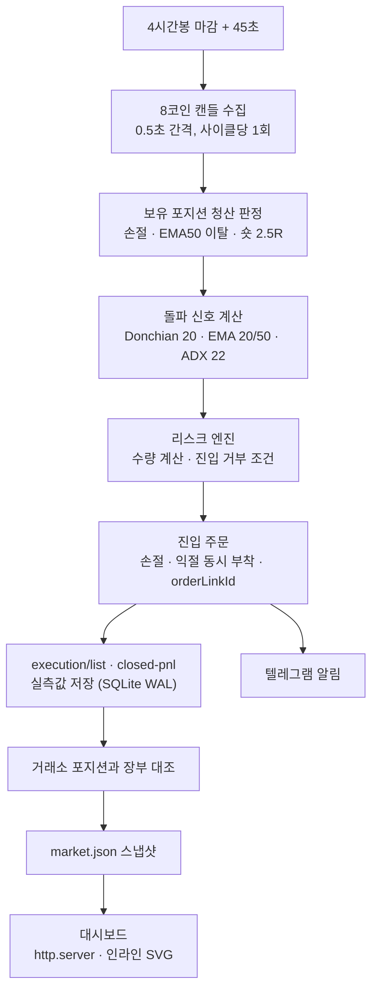

# metis-rule-trader

Bybit USDT 무기한 선물 대상의 규칙 기반 자동매매 엔진입니다. 인공지능이나 머신러닝 모델의 판단 없이 사전에 정의된 기술적 규칙에 따라 매매를 수행합니다. 앞선 AI 판단 기반 엔진 실험은 [metis-ai-trader](https://github.com/deltaomega02/metis-ai-trader) 저장소에 정리되어 있습니다.

---

## 1. 운영 기록

GCP e2-micro(메모리 1GB) 단일 인스턴스에서 systemd 서비스로 상시 가동했습니다. 2026년 5월 29일 페이퍼 엔진 가동을 시작했고, 2026년 6월 8일 실거래를 시작해 2026년 7월 13일에 운영을 종료했습니다.

* **실거래와 페이퍼 동시 가동:** 실거래와 페이퍼를 별도 프로세스 2개로 분리해 동일한 시세 신호에 대해 동시에 실행했습니다. 이를 통해 백테스트상 가정 체결가와 실제 시장 체결가 사이의 슬리피지를 측정하고 비교했습니다.
* **실거래 결과:** 운영 기간 동안 총 24건의 실거래 체결이 발생했습니다. 통계적 기대값을 판단하기에는 표본 수가 작았으며, 최종 누적 결과는 손실을 기록했습니다.

---

## 2. 규칙 기반으로 전환한 이유

이전 세대인 `metis-ai-trader`(METIS v1~v3)에서는 LLM 등 AI 모델을 매매 판단에 활용했습니다. 하지만 실거래 표본이 부족한 상태에서 손실이 이어졌고, AI의 비결정론적 판단 특성상 과거 시세 데이터로 동일한 상황을 재현하거나 장기 시뮬레이션을 통해 검증하기 어려웠습니다.

반면 명확한 규칙 기반 전략은 장기 과거 데이터를 바탕으로 통계적 기대값을 검증할 수 있습니다. 시스템의 동작을 결정론적으로 통제하고 사후 분석을 명확히 하기 위해 규칙 기반 아키텍처로 전환했습니다.

---

## 3. 매매 전략

대상 코인은 8종(BTC, ETH, SOL, XRP, BNB, DOGE, ADA, AVAX)이며, 4시간봉(설정을 통해 1일봉 추가 가능)을 기준으로 삼습니다. 신호 계산은 직전에 마감된 봉의 확정 종가만 사용합니다.

### 진입 조건

| 구분 | 진입 조건 |
| --- | --- |
| **롱 (Long)** | 종가 > 직전 20봉 최고가(Donchian 20 돌파) and EMA(20) > EMA(50) and ADX(14) > 22 |
| **숏 (Short)** | 종가 < 직전 20봉 최저가(Donchian 20 이탈) and EMA(20) < EMA(50) and ADX(14) > 22 |

### 청산 규칙과 설계 이유

* **손절 기준:** 방향과 무관하게 진입가 기준 `1.5 × ATR(14)` 거리에 고정 손절을 설정합니다.
* **롱 청산:** 별도의 고정 익절가 없이 종가가 EMA(50) 아래로 하향 돌파하면 전량 청산합니다. 추세를 가능한 길게 유지하는 추세 추종 방식입니다.
* **숏 청산:** 손절 폭 대비 2.5배 거리(2.5R)에 고정 익절 주문을 둡니다.
* **방향별 청산 분리 이유:** 하락 추세에서 롱과 동일하게 EMA(50) 상향 돌파로 숏을 청산하면, 진입 시점 기준으로 EMA(50) 선이 진입가보다 한참 위에 형성되어 있는 경우가 많습니다. 이로 인해 단기 급락 후 반등 구간에서 이미 확보한 이익을 대부분 반납하고 나서야 청산되는 구조적 문제가 발생했습니다. 백테스트 결과에 따라 숏은 2.5R 고정 익절로 확정했습니다.

### 백테스트를 통해 기각된 청산 변형

장기 시뮬레이션 결과 기준 전략 대비 성과가 떨어져 다음 방식들은 채택하지 않았습니다.

* 트레일링 스톱(Trailing Stop)
* 분할 익절
* 추세 지표 약화 시 청산
* 롱 포지션 고정 익절
* 익절 체결 후 즉시 재진입

---

## 4. 리스크 관리

단일 거래의 손실 한도를 통제하고 시스템 자본을 보호하기 위해 리스크 계산을 거쳐 주문을 생성합니다.

### 수량 및 레버리지 산정

* **거래당 손실 한도:** 계좌 자본의 0.75%로 제한합니다.

```text
주문 수량 = (총 자본 × 0.0075) ÷ 손절 거리
```

계산된 수량은 거래소 최소 주문 단위로 내림 처리합니다.

* **레버리지:** 3배로 고정합니다. 거래 손익은 투입 수량에 의해 결정되며, 레버리지는 강제 청산 가격 여유도에만 영향을 줍니다.

### 진입 거부 조건

다음 조건 중 하나라도 충족되면 신호가 발생해도 주문 집행을 차단합니다.

| 거부 조건 | 판정 기준 |
| --- | --- |
| **수동 정지 스위치** | 운영자가 설정한 거래 일시 중단 플래그 활성화 시 |
| **동시 보유 한도** | 현재 열려 있는 포지션이 4개에 도달했을 때 |
| **일일 손실 한도** | 당일 실현 손실이 계좌 자본의 4%에 도달했을 때 |
| **최대 낙폭(MDD) 제한** | 자본 곡선이 역사적 고점 대비 25% 이상 하락했을 때 |
| **최소 수량 미달** | 계산된 주문 수량이 거래소 최소 주문 단위를 밑돌 때 |

---

## 5. 시스템 실행 구조

단일 `asyncio` 이벤트 루프 기반으로 동작합니다. 4시간봉 마감 직후 정각에 거래소 서버로 몰리는 트래픽을 피하기 위해, 마감 45초 뒤에 분석 사이클을 시작합니다. 8개 코인 시세는 사이클 시작 시 0.5초 간격으로 1회씩 수집하여 메모리에서 공유합니다.



### 안정성 설계

* **원자 주문 (Atomic TPSL):** 진입 주문을 제출할 때 손절가와 익절가를 한 번에 묶어서 전송합니다(`tpslMode=Full`). 봇 프로세스나 서버에 장애가 발생해도 거래소 주문 엔진 차원에서 손절이 체결됩니다.
* **orderLinkId와 멱등성:** 주문마다 고유한 `orderLinkId`를 부여하여 일시적 네트워크 순단으로 재시도하더라도 주문이 중복 생성되는 현상을 차단합니다. 10006, 10016, 10018 등 거래소 Rate Limit·서버 에러 발생 시 지수 백오프로 대기 후 재시도합니다.
* **장부 대조 (Reconciliation):** 부팅 시점 및 매 4시간 사이클마다 Bybit 실제 포지션과 로컬 SQLite 장부를 대조합니다. 거래소에서 자체 체결된 손절 포지션을 파악해 장부를 갱신하고, 부팅 시에는 장부에 없는 포지션을 가져와 기록합니다.
* **실측치 보존:** 체결가, 거래 수수료, 실현 손익은 거래소 원본 API(`execution/list`, `closed-pnl`) 응답 데이터를 그대로 SQLite(WAL 모드)에 저장합니다. 신호 기준가와 실제 체결가를 함께 남겨 실환경 슬리피지를 지속적으로 측정합니다.
* **1GB 메모리 최적화 대시보드:** 무거운 웹 프레임워크나 시각화 라이브러리를 배제하고, Python 표준 라이브러리 `http.server`와 순수 인라인 SVG를 사용하여 대시보드를 구성했습니다. 대시보드는 엔진 프로세스가 사이클마다 기록하는 `market.json` 스냅샷과 SQLite 장부를 읽기 전용으로 읽습니다. 캔들은 엔진만 받고, 대시보드는 시세만 15초 캐시를 두고 조회합니다. `numpy`도 임포트하지 않습니다.
* **알림 및 로깅:** 진입, 청산, 정기 사이클 상태, 시스템 에러를 텔레그램으로 전달합니다. 공개용 코드 정리 과정에서 민감정보 노출 방지를 위해 `httpx` 로거 레벨을 조정하여 URL 파라미터가 포함된 요청이 INFO 로그에 남지 않도록 제한했습니다.

---

## 6. 백테스트 검증

`research/` 디렉터리의 시뮬레이션 엔진을 통해 과거 데이터를 검증했습니다. 거래소 펀딩비와 2bp 슬리피지를 공제한 상태로 지표를 산출했습니다.

### 데이터 및 성과 지표

* **검증 데이터:** 8개 코인 4시간봉 데이터(2020년~2026년, 코인별 약 4.6~5.9년)
* **구간 분할:** 파라미터를 고정한 채 전체 기간을 앞단 70%와 뒷단 30%로 나누었으며 두 구간의 평균 R은 각각 +0.414R, +0.086R로 양수였습니다. 기간을 5등분한 검증에서도 각 구간의 평균 R이 모두 양수였습니다.
* **파라미터 민감도:** 2,400개 파라미터 조합 그리드 탐색에서 현재 설정을 모든 지표에서 앞서 보이는 조합이 110개 나왔습니다. 다만 대표 후보 3개를 부트스트랩으로 비교하니 현재 설정보다 나을 확률이 26~60%로 우연 수준이었습니다.

| 지표 | 결과치 |
| --- | --- |
| **거래당 기대값** | +0.315R (전체 신호 1,718건, 동시 보유 제한 없음) |
| **전체 승률** | 28.5% |
| **MDD 중앙값** | 30% (몬테카를로 시뮬레이션 기준) |
| **MDD 50% 초과 확률** | 약 2% (몬테카를로 시뮬레이션 기준) |

전형적인 추세 추종 특성으로 낮은 승률(28.5%)을 유지하면서, 손실 거래는 작게 끊고 추세가 터지는 거래에서 크게 수익을 내는 구조입니다.

### 설계 파라미터 결정 근거

* **코인 종목 수(8개):** 같은 전략으로 코인을 12개, 16개, 23개로 늘려 비교했으나 거래당 기대값과 연수익률은 낮아졌습니다. 다만 뒤 30% 구간 기대값이나 MDD는 12개·23개가 더 나은 경우도 있었습니다.
* **봉 주기(4시간봉):** 15분봉은 BTC·ETH·SOL 약 1.5년치에 같은 돌파 규칙을 적용했을 때 슬리피지 없이도 거래당 기대값이 음수였습니다. 1시간봉은 현재 청산 규칙에 2bp 슬리피지를 반영하면 거래당 +0.027R로, 4시간봉(+0.315R)의 10분의 1 수준이었습니다. 노이즈와 거래 비용을 고려했을 때 4시간봉이 안정적이었습니다.

### 백테스트의 한계

약 4.6~5.9년의 데이터는 암호화폐 시장 전체로 보면 하나의 큰 사이클(상승-하락-횡보)에 불과합니다. 따라서 도출된 기대값의 '양수 부호(+)'는 전략 논리의 유효성으로 보되, 산출된 기대값의 크기는 할인해서 보수적으로 해석해야 합니다.

---

## 7. 기술 스택

| 영역 | 기술 요소 |
| --- | --- |
| **언어 및 런타임** | Python 3, asyncio |
| **연산 및 라이브러리** | numpy, httpx, python-dotenv |
| **데이터베이스** | SQLite3 (WAL 모드) |
| **외부 API** | Bybit V5 REST API, Telegram Bot API |
| **인프라 및 운영** | GCP Compute Engine (e2-micro, 1GB RAM), systemd |

---

## 8. 프로젝트 구조

```text
metis-rule-trader/
├── config/
│   └── settings.py          # 설정값 단일 출처 (환경변수 매핑)
├── core/
│   ├── indicators.py        # numpy 기반 기술적 지표 (EMA, ATR, ADX, Donchian)
│   ├── breakout_signal.py   # 진입 신호 생성 및 청산 기준 판정
│   ├── risk_engine.py       # 자본 대비 주문 수량 산출 및 진입 거부 조건 검사
│   ├── scheduler.py         # 4시간봉 마감 주기 스케줄러 (+45초)
│   ├── state_store.py       # SQLite WAL 기반 포지션/거래/자본 장부
│   └── market_snapshot.py   # 대시보드 연동용 market.json 스냅샷 생성
├── exchange/
│   ├── bybit_client.py      # Bybit V5 REST 클라이언트 및 에러 백오프 재시도
│   ├── executor.py          # 실제 거래소 주문 집행 및 원본 체결값 저장
│   └── paper_executor.py    # 페이퍼 트레이딩 모의 체결 및 가상 장부 기록
├── observability/
│   ├── telegram.py          # 상태 및 체결 텔레그램 알림 발송
│   └── dashboard.py         # 표준 라이브러리 기반 경량 인라인 SVG 웹 대시보드
├── deploy/
│   ├── metis-v6.service           # 실거래 엔진 systemd 유닛
│   ├── metis-v6-paper.service     # 페이퍼 엔진 systemd 유닛
│   └── metis-v6-dashboard.service # 대시보드 systemd 유닛
├── research/                # 백테스트 및 과거 시세 수집 스크립트
├── .env.example
├── main.py                  # 엔진 실행 진입점
└── requirements.txt
```

---

## 9. 실행 방법 및 백테스트 재현

### 엔진 실행

```bash
python3 -m venv venv
source venv/bin/activate
pip install -r requirements.txt

cp .env.example .env    # PAPER_MODE=true 면 거래소 키 없이 공개 시세로 동작
python3 -u main.py

# 대시보드는 별도 프로세스 (기본 http://localhost:8501)
python3 -u observability/dashboard.py
```

`.env.example`을 복사해 `.env`를 생성합니다. `PAPER_MODE=true`로 설정하면 거래소 API Key 없이 공개 시세 REST API만 조회하여 모의 투자를 수행합니다.

### 백테스트 재현

```bash
cd research
pip install requests          # 캔들 수집 스크립트만 추가로 사용
# 4시간봉, 약 6년치, 8코인을 research/data 에 저장
python3 fetch_15m.py 240 72 BTCUSDT,ETHUSDT,SOLUSDT,XRPUSDT,BNBUSDT,DOGEUSDT,ADAUSDT,AVAXUSDT
python3 validate_breakout.py  # 돌파 전략 기본 검증
python3 grid_sweep.py         # 파라미터 그리드 탐색
python3 final_validation.py   # 롱 전용 + BTC 상승 게이트 변형 검증
python3 montecarlo.py         # 몬테카를로 낙폭 분포
```

---

## 10. 시스템 한계

1. **자동화된 단위/통합 테스트 부재:** 별도의 테스트 코드 스위트가 구축되어 있지 않으며, 백테스트 스크립트 검증과 페이퍼·실거래 운영으로 안정성 확인을 대신했습니다.
2. **orderLinkId 생성 구조:** `orderLinkId`가 타임스탬프 시각 기반으로 생성됩니다. 동일 프로세스 내 네트워크 재시도에 따른 중복 주문은 차단되지만, 만약 주문 전송 직후 프로세스가 갑작스럽게 강제 재시작되면 동일한 결정에 대해 새로운 ID가 부여되어 중복 주문이 발생할 이론적 가능성이 남아 있습니다.
3. **제한된 실거래 표본:** 실거래 운영 기간 동안 누적된 거래는 24건입니다. 이 표본 수로는 백테스트에서 도출된 통계적 기대값이 실환경에서도 일치하게 발현되는지 충분히 입증하기 어렵습니다.

---

이 저장소의 코드는 시스템 엔지니어링 및 알고리즘 검증을 위한 개인 프로젝트 기록이며, 어떠한 투자 조언도 제공하지 않으므로 실제 자금 운용에 사용해서는 안 됩니다.
